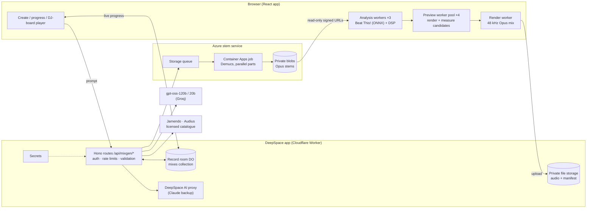

# CrowdPilot: an AI DJ that turns a sentence into a beat-matched mix

- **Live app:** https://crowdpilot.app.space
- **Repository:** https://github.com/smokyfishy/CrowdPilot (branch `main`)
- **Stack:** DeepSpace (Cloudflare Workers, Durable Object record rooms, private file storage, AI
  proxy, secrets), React 19, TypeScript, Web Workers, ONNX Runtime Web, an Azure Container Apps
  stem service

You type a prompt like *"a 5-minute tech house set with 5 songs that builds gradually"*.
CrowdPilot interprets it with an LLM, finds licensed music, runs neural beat tracking and stem
separation, plans the whole set with a global search, performs every transition with staged
fader, EQ, filter, echo and stem automation, test-listens to its own candidate transitions, and
delivers a continuous, beat-matched mix in a DJ-board player that explains every move.

---

## Try it

1. Open https://crowdpilot.app.space and sign in (Google or GitHub). You land on the mix
   generator.
2. Describe a **5-minute set with about 4–6 songs**. The **Try:** buttons under the prompt box
   fill one in, for example:
   - *"A 5-minute tech house set with 5 songs that builds gradually, with strong basslines and
     smooth long blends."*
   - *"A 5-minute EDM set with 4 songs, building into every drop with drop swaps and no loop
     rolls."*
3. Press **Generate** and watch the live progress, which streams from a DeepSpace record room.
   A 5-minute set renders in about 6 minutes.
4. Play the mix. The DJ board animates both decks, the faders, EQ, filters and stems in sync with
   the audio. **How the AI DJ made this mix** explains every transition in plain words.

**Why a 5-minute, 4–6-song set:** each transition is test-rendered several ways and measured
before the final render (about 50–60 renders per mix), so a short set gives the fastest
turnaround while showing the full pipeline. Longer sets are supported. For best results, ask for
genres, moods and techniques; the live catalogue is licensed Creative Commons and Audius music.

---

## Technical highlights

- **A full DJ performance engine built in TypeScript.** It includes global set planning, staged
  long-form transitions, a closed listening loop, and a sample-accurate renderer with WSOLA tempo
  stretching and key lock.
- **Eight models in the pipeline:**
  - **Beat This!:** a neural beat and downbeat tracker, running with ONNX in the browser.
  - **Demucs htdemucs:** 4-stem separation (vocals, drums, bass, other) on Azure.
  - **MixGraph:** two LightGBM models, for pairing quality and a human cue prior.
  - **TransitionNet v1 and v2:** MLPs that propose automation curves and staged strategies.
  - **DJCritic:** two LightGBM models, for perceived quality and artifacts.
- **Browser-side compute at scale.** Analysis, previews and the final render run in Web Workers,
  so per-mix compute costs nothing on the server. A pool of up to 4 preview workers makes the
  closed loop several times faster.
- **Pro-DJ house rules, enforced in code:**
  - every transition beat-matched within a DJ pitch fader's ±8 % with key lock;
  - at least 16 bars per transition;
  - beat-matching on steady drum sections only, with constant-tempo grids fitted to drifting
    tracks;
  - no loop rolls.
- **Deep DeepSpace integration:**
  - Auth gates every route.
  - Record rooms hold each mix as an owner-only row, with writes coming only from the server.
  - Private storage holds the audio.
  - The AI proxy provides a backup interpreter.
  - Secrets hold every credential.
  - Every release deploys from GitHub `main`, and every deploy is checked by a live browser test.

---

## Architecture

**Generation pipeline** (`src/mixgen/pipeline.ts`):

1. **Interpret.** The request is turned into a structured spec by an open-weight LLM with JSON-schema
   output, then checked by a deterministic guard.
2. **Discover and license-check.** Candidate tracks come from Jamendo and Audius, keeping only
   licences that allow remixing.
3. **Download and analyse** in parallel workers. Stem separation is requested as soon as each
   track is analysed.
4. **Plan the whole set**: a beam search over order × cue points × overlap length.
5. **Design each transition** as a staged performance with real control lanes.
6. **Closed loop**: render the candidates in parallel, measure them, refine, and re-plan around any
   transition that fails.
7. **Final render** with stems, then automatic audio validation, private upload, and a manifest
   for the player.

---

## DeepSpace integration in depth

### Authentication and authorization
- **Client:** `DeepSpaceAuthProvider` wraps the app. `AuthGate` protects everything under `/mix`,
  with an in-app sign-in panel as the fallback, and `AuthOverlay` handles Google and GitHub
  sign-in from the navigation bar.
- **Social sign-in:** goes through the platform's code exchange and sets an HttpOnly session
  cookie, then lands the user directly on `/mix` (`src/server/http-routes.ts`).
- **Server:** every `/api/mixgen/*` route resolves the caller from the DeepSpace JWT before doing
  anything. Each expensive operation has its own per-user token bucket: interpret 10/min,
  discover 6/min, stems 30 per 10 min, audio 120/min, writes 240/min.

### Record rooms (Durable Objects) as the mix database
- **The collection:** `mixes` (`src/schemas/mixes-schema.ts`) is a typed collection with
  `ownerField: 'ownerUserId'`. Its role permissions let members **read only their own rows** and
  **forbid every client write**.
- **Server-only writes:** all writes go through the server. `createRoomTools` (in
  `src/server/room-tools.ts`) calls the app-scope record room Durable Object directly, acting as
  the signed-in user under the app's action identity. Creating a version, the review-step track
  list, throttled progress updates (batched every 1.5 s), the final summary and deletes are all
  validated on the server before they're written.
- **Live progress:** the client subscribes with `useQuery('mixes')`, so the progress screen and
  the mix library update live with no polling code.
- **Version history:** each refinement ("make it darker", "swap track 3") is a new row linked by
  `parentId` and `rootId`.

### Private file storage
- **The audio:** the rendered 48 kHz Opus mix and its full manifest (timeline, automation curves,
  analysis, model trace) are uploaded with `useR2Files` into the user's **self scope**.
- **The row:** the record keeps only the storage keys, so audio never sits in the database and
  stays private to its owner.
- **On the server:** `appFiles(env, { scope: 'self', userId })` reads and deletes them (for
  example, when the user deletes a mix).

### DeepSpace AI proxy
- **Backup interpreter:** `createDeepSpaceAI(env, 'anthropic', { authToken })` provides Claude
  Sonnet as a second-line interpreter.
- **Billing:** it's billed to the signed-in user, so the app needs no model key and one heavy
  user can't run up the owner's costs.
- **The chain:** gpt-oss-120b → gpt-oss-20b (separate free quota) → Claude via DeepSpace →
  deterministic parser. A request is always interpreted.

### Secrets
- **What's stored:** `GROQ_API_KEY`, the Azure queue and blob signed URLs, and
  `JAMENDO_CLIENT_ID` are set with `deepspace secrets set … --stdin`.
- **Where they live:** they're read only in the Worker, never shipped to the client, and never in
  the repo.
- **Least privilege:** the Azure signed URLs can only add messages to the queue and only read
  stems.

### Deploy, releases and verification
- **Release history:** 35+ releases with `npx deepspace deploy`. Each is tied to a GitHub commit,
  and every one can be rolled back.
- **Verified on the live app:** every release was checked with a real browser end-to-end test
  against `crowdpilot.app.space`, covering sign-in → describe → generate → listen → inspect.
  The suite also checks responsive layout at 320–1280 px, and that the page has a single
  scrollbar.

### Platform features chosen on purpose
- **Composio and Google integrations:** not used. CrowdPilot doesn't act on users' accounts.
- **Payments:** no paid tier in this build.
- **Cron:** generation is on demand.
- **Yjs and canvas rooms:** a mix is authored by one person; the record room's live
  subscriptions already provide the real-time behaviour the product needs.

---

## The AI DJ engine

### Understanding the request (`src/mixgen/spec.ts`, `src/server/llm.ts`)
- **Structured output:** the model returns JSON that must match a schema, using low reasoning
  effort and one automatic repair round.
- **Deterministic guard:** anything the user stated explicitly is enforced even if the model
  drops it. That covers duration, track count, BPM, genres, named songs, era, intensity words and
  named techniques ("drop swaps", "no loop rolls").
- **Binding techniques:** each technique carries a prefer or avoid flag that the planner and the
  closed loop must honour.

### Global set planning (`src/mixgen/setplan.ts`)
- **Beam search** over complete sets. Each state tracks the track order, the last track's entry
  point, duration so far, and recent techniques.
- **Edges** are phrase-aligned windows of 16, 32, 48 or 64 bars, scored with bar-level
  compatibility: bass collision, vocal overlap, percussion load, harmony and energy slope.
- **Set-level terms:** a narrative energy curve, tempo drift, genre coherence, vocal
  distribution, technique variety, and a near-hard fit to the requested duration.
- **Short-set mode:** wider cue windows, late starts and early endings with fades. A 5-minute
  request lands within a few seconds of 5 minutes.

### Beat-matching like a DJ (`src/dj/transitions.ts`, `src/dj/phase.ts`)
- **Tempo range:** ±8 % tempo matching (the range of a DJ's pitch fader), with key-locked WSOLA
  stretching and a tempo recovery ramp.
- **Steady sections only:** each window is beat-matched on the actual Beat This! beats inside it
  (`steadyBpm`). Tracks with breakdowns or half-time intros are mixed in and out on their steady
  drum sections, with entry and exit cues offered at every phrase start inside one.
- **Constant-tempo grids:** fitted to tracks whose beat tracker drifts only in beatless sections
  (`constantGrid`), as DJ software does.
- **Alignment check:** every candidate's predicted beat alignment is checked against both beat
  grids before it can be chosen.

### Staged long-form transitions (`src/mixgen/longform.ts`)
- **Five stages:** introduce → layer → develop → transfer → resolve. The boundaries come from the
  music itself: where the basslines can swap, the gaps between vocal phrases, and the incoming
  drop.
- **Strategies:** layered blend, percussion build, vocal handoff, filter ride, echo handoff, stem
  mashup and drop lock.
- **Control lanes:** each strategy compiles to per-deck gain, 3-band EQ, filter, echo, crossfader,
  tempo and 4-stem lanes, all executed by the renderer at sample resolution.

### The closed listening loop (`src/mixgen/closedloop.ts`, `src/mixgen/audio-quality.ts`)
1. **Render:** every candidate is rendered with the production renderer, from 8 bars before to
   8 bars after the transition.
2. **Measure:** beat alignment, phrase error, harmonic clash, vocal clash, bass masking,
   percussion coherence, loudness continuity, clipping and silence, stretch artifacts, stem
   leakage and effect fit, plus DJCritic.
3. **Reject** anything that hard-fails, refine the best (shift cues by a phrase, change the length,
   toggle stems), and feed the measured costs back into the planner, which re-plans the set.
4. **Spread the budget fairly** across transitions, so every transition in the final set is
   measured.
5. **Run it in parallel:** a pool of Web Workers renders and measures previews, and makes exactly
   the same choices as the single-thread path (unit tested).

### Stem separation service (`infra/stems/`)
- **The service:** an Azure Container Apps job triggered by a storage queue, running Demucs
  htdemucs (4 stems). It scales to zero, runs up to 48 executions in parallel, and has a budget
  alert.
- **Parallel parts:** each track is split into parts of about 45 s, which are separated in
  parallel and stitched with 1 s crossfades inside 5 s of padding. Reconstruction residual:
  −17.9 dB split vs −16.8 dB whole.
- **Prefetching:** stems are requested while the rest of the tracks are still being analysed, and
  shared across the review and render passes.
- **Quality gate:** each separation is checked for bass bleed and reconstruction residual before
  stem routing is allowed.

---

## Results

| Measure | Result |
|---|---|
| Request understanding (24 varied prompts, each field scored) | **94/94 fields (100 %)** with gpt-oss-120b + guard, vs 74 % for a rule-based parser |
| "5-minute mix with drop swaps, no loop rolls" on real audio | **5:10, 4/4 drop swaps, no loop rolls** |
| Named techniques on real audio | Filter sweeps **7/7**, drop swaps **4/4**, echo handoffs **4/5**, all at least 16 bars |
| Beat-matching on a hard set (breakdowns, half-time intros, 128–142 BPM) | **4/4 transitions beat-matched**, beat alignment within 0–8 ms |
| Closed-loop planning, live | **16–52 s** with the worker pool (was 92–227 s single-threaded) |
| End-to-end live run (sign in → generate → listen → inspect) | Passes on the current release; a 5-track mix in about 6.5 min of generation |
| Automated tests | **233 passing** (186 integration, 47 ML/DSP) |

**How the models are used.** All eight models run on every mix. The learned transition models act
as *candidate generators*: their proposals are rendered and measured by the closed loop, and win
when they measure best. Promotion to decision-maker is gated on held-out evaluation (registry and
model cards in [`docs/MODEL_CARDS.md`](docs/MODEL_CARDS.md), with the full study in
[`docs/PRO_DJ_REPORT.md`](docs/PRO_DJ_REPORT.md)). This keeps the explicit audio measurements as
the final judge, so a learned model can add good options but can never push a bad transition into
a mix.

---

## Main tradeoff: mix quality over raw speed

I chose to make every mix sound like a professional DJ made it: beat-matched, long, layered
transitions, each verified by test renders. The cost is generation time, about 6 minutes for a
5-minute set, against roughly 2 minutes for a planner that renders once without listening.

I reduced that cost with engineering rather than by lowering quality:
- previews run in a parallel worker pool;
- stems are prefetched during analysis and separated in parallel parts;
- the render pass reuses the closed-loop result instead of searching again;
- each track's preview audio is loaded once, in parallel.

Together those took a fresh mix from 8.6 to about 6.5 minutes of generation.

A second, related choice: **heavy compute runs in the browser.** Workers can't run ONNX models or
long DSP, and a server farm for audio rendering would cost money on every mix. Running it in Web
Workers costs nothing per mix and scales with users. Only stem separation, which needs a large
PyTorch model, runs on a server.

---

## Security and rights

- **Secrets** live only in DeepSpace secrets and are read in the Worker. Azure access uses
  least-privilege signed URLs.
- **Every API route** is authenticated and rate-limited per user. Mix rows are owner-read-only
  with server-only writes, and audio lives in per-user private storage.
- **Licences** are checked from the source's current metadata, and checked again before stems are
  made (stems are derivatives). Credits and licence links ship with every mix.
- **Mainstream-song research mode** runs locally only, behind `CP_RESEARCH_YOUTUBE=1`, and is
  never deployed.

---

## Working with the coding agent

**What the agent did.** I directed Claude Code as the implementer:
- I gave it the product requirements, the mixing rules and the architecture choices.
- It wrote the implementation and the tests, ran benchmarks and real-audio evaluations, deployed,
  and ran live browser tests after each change.

**What I verified and decided myself:**
- **Listening:** I listened to the mixes and used the live app as a user. I fed back concrete
  problems (a 5-minute request coming out at 11:42, drop swaps coming out as loop rolls, sign-in
  landing on a missing page, a wrapped "TEMPO" label, a double scrollbar, panels that read like a
  debugging report) and had each one fixed and re-checked on the live site.
- **Mixing rules:** I set them myself: beat-match every transition like a DJ, at least 16 bars,
  no loop rolls.
- **Stack choices:** I chose the Azure stem service, running all models with the measured best
  output winning, and a free open-weight interpreter.
- **Blind listening:** I rated a blind A/B listening set to check the audio metrics against
  human judgement.
- **Evidence:** I required proof on real audio and on the live site for every change. Benchmarks
  were re-run at a realistic request rate before their numbers were accepted.

---

## Roadmap

- **Shared analysis cache:** cache track analyses on the server by audio hash, so popular tracks
  are never analysed twice. This would bring a mix down to about 3 minutes.
- **GPU stems and pre-warming:** move Demucs to GPU and warm the stem service when the create
  page opens.
- **Loudness in the planner:** make loudness matching a hard planner term, with gain riding
  inside long blends.
- **Instrumental filtering:** treat vocal activity as a hard filter when "instrumental" is
  requested.
- **Model promotion:** collect more human-rated transitions to promote the learned models from
  candidate generators to decision-makers.
- **Larger catalogue:** add licensed mainstream catalogues.

---

## Code tour

| Path | What's there |
|---|---|
| `src/server/mixgen-routes.ts` | Authenticated, rate-limited API: interpret, discover, licensed audio proxy, stems, mix versions |
| `src/server/room-tools.ts` | Server-side record room access (Durable Object action identity) |
| `src/schemas/mixes-schema.ts` | `mixes` collection: owner field, read-own / no-client-write permissions |
| `src/server/llm.ts` | Open-weight LLM client (JSON schema, retry on rate limit) |
| `src/mixgen/spec.ts` | Request schema, interpreter prompt, deterministic guard, techniques |
| `src/mixgen/pipeline.ts` | End-to-end generation pipeline and stage timings |
| `src/mixgen/setplan.ts` | Global set planner and beat-matching rules |
| `src/mixgen/longform.ts` | Staged long-form transitions |
| `src/mixgen/closedloop.ts` | Render → measure → refine → re-plan |
| `src/mixgen/browser/` | Browser host: analysis, preview-pool and render workers; stem client |
| `src/dj/` | Renderer, transition styles, beat and phase tools (WSOLA, constant grids) |
| `src/ml/` | TypeScript inference for the learned models (parity-tested against Python) |
| `src/components/mix/` | Create, progress and player UI, DJ board, explanation panels |
| `infra/stems/` | Azure stem job, provisioning script, operations README |
| `evaluation/` | Benchmarks and real-audio evaluation harnesses |
